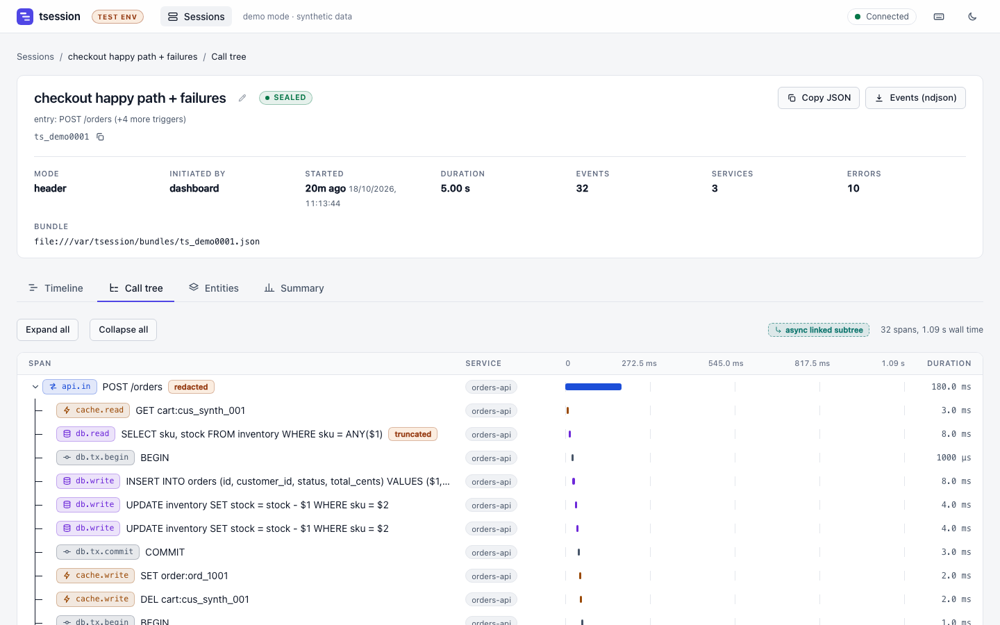

# tsession

Session-scoped tracing and data-mutation capture for **test environments**.

Start a *session*, exercise the system, stop the session. tsession then shows, for that session only, what ran,
in what order, across which services, and which rows, keys and documents changed.

It is not a general-purpose APM: traffic outside a session is not recorded. It records request and response
payloads, masked by field name only, so run it against test data. See [`SECURITY.md`](SECURITY.md).

## Try it

```bash
go run ./cmd/dashboard -demo            # http://127.0.0.1:7072, synthetic data, nothing else needed
```





## Run the stack

Building this repository needs Go 1.26 (`go.work`); importing the modules needs Go 1.25+.

```bash
# three terminals
go run ./collector/cmd/collector        # :7071
go run ./cmd/controlplane               # :7070
go run ./cmd/dashboard                  # :7072

# or everything in containers (Postgres + Redis + all services)
cp docker/.env.example docker/.env      # synthetic dev values; edit before use
make up                                 # then open http://127.0.0.1:7072
make down                               # when finished; this also deletes the recorded data
```

To move a port: `--listen` (collector, control plane), `-listen` (dashboard). Then point the services and
`tracectl` at the new addresses with `TSESSION_CONTROLPLANE_URL` and `TSESSION_COLLECTOR_URL`. Run the collector
from a directory you choose: it writes sealed bundles to `./bundles` there.

## Instrument a service

```go
import (
    _ "github.com/maheshpaliwal/agentic-test-session/sdk/autoinit" // starts the SDK from TSESSION_* env vars
    "github.com/maheshpaliwal/agentic-test-session/thttp"
)

func main() {
    handler := thttp.Handler(mux)               // inbound: attribution + capture
    client  := thttp.Client(http.DefaultClient) // outbound: propagation
    // ...
}
```

```bash
TSESSION_ENABLED=true \
TSESSION_SERVICE=orders-api \
TSESSION_CONTROLPLANE_URL=http://127.0.0.1:7070 \
TSESSION_COLLECTOR_URL=http://127.0.0.1:7071 \
  ./orders-api
```

- Wrap handlers and clients inside `main` or functions it calls. The wrappers decide once, when called, whether
  the SDK is on; a package that wraps at init time must itself import `autoinit`.
- `autoinit` also traces `http.DefaultTransport`. `thttp.Client` sends session headers to every host it calls,
  third parties included; `TSESSION_PROPAGATE_HOSTS` and `TSESSION_NO_PROPAGATE_HOSTS` apply only to the default
  transport.
- Other wrappers live under `contrib/`: gRPC, SQL, Redis (go-redis v8 and v9), Mongo, DynamoDB, queues (Kafka,
  SQS, AMQP). Each package's doc comment shows its setup.

## Record a session

```bash
go build -o tracectl ./cmd/tracectl      # or: go run ./cmd/tracectl <command>

tracectl doctor                          # both services answer; which services are connected
tracectl start --name my-run             # prints the session as JSON; the id is the "id" field
curl -H 'x-tsession-id: <id>' http://127.0.0.1:8080/orders
tracectl stop my-run --wait              # drains async work, then seals
```

A request joins a session through `x-tsession-id: <id>`, or through an attribute bound to the session (user-id
header, JWT claim, cookie, query parameter; see [`docs/BINDING.md`](docs/BINDING.md)). Only the first
instrumented hop needs it; the session propagates downstream, including through message queues. A session
started with `--mode exclusive` records every request while it runs.

## Read the results

```bash
tracectl summary my-run                      # counts, mutations, failures
tracectl events my-run --kind 'db.*' --errors
tracectl entities my-run                     # what the session changed
tracectl history my-run postgres orders 42   # every change to one row, with diffs
tracectl trace my-run --errors               # call tree, only branches that failed
tracectl show my-run 17                      # one event in full: request, response, mutations
tracectl diff nightly-ok nightly-failed      # what differs between two runs
tracectl list --limit 20                     # the newest sessions
```

Exit status: `0` ok, `1` failed (including bad arguments to a command), `2` unknown command or global flag,
`3` a `--fail-on-*` check failed.

## Go tests and CI

`sdk/client/tsessiontest` ties a session to a test and asserts on what it recorded:

```go
sess := tsessiontest.Run(t, client.Options{})   // stopped when the test ends
// ... drive the system with sess.Header() or sess.Transport(nil) ...
tsessiontest.RequireNoFailures(t, sess)
tsessiontest.RequireMutation(t, sess, client.MutationFilter{Store: "postgres", Entity: "orders", Op: "insert"})
```

Stopping a session waits for it to go quiet (3s by default), so each such test takes a few seconds; lower
`client.Options.QuiesceSeconds` if your system has no asynchronous work.

`sdk/client` gives the same data directly (`Start`, `StopAndWait`, `Summary`, `Events`, `Mutations`, `History`,
`Trace`).

```bash
# gate: exit 3 on failed events, an incomplete session (a failed seal or timed-out drain included), or no events at all
tracectl report my-run --fail-on-error --fail-on-incomplete --fail-on-empty >> "$GITHUB_STEP_SUMMARY"
tracectl report my-run --format junit -o tsession-junit.xml

# keep a run after the job is gone: export it, then open the file without the services
tracectl export my-run -o run.ndjson
go run ./cmd/dashboard -open run.ndjson

# or let failed Go tests save theirs
TSESSION_ARTIFACT_DIR=$PWD/artifacts go test ./...
```

An export holds recorded payloads, masked by field name only. Treat it like test data, not as something safe to
share; whether it may go to CI storage is a question for your own data-handling policy. The opened session is
named after the file.

## The session is empty?

1. `tracectl doctor` lists the service as connected. If not: `TSESSION_ENABLED` must be exactly `true`, and the
   service logs `tsession: enabled ...` at start when it is.
2. The handlers were wrapped after the SDK started (see "Instrument a service"). If not, the service still
   shows as connected, and logs `tsession: thttp.Handler was called before the SDK started` at start.
3. In containers, the control plane and collector accept loopback Host names only. Add the service names with
   `--allowed-hosts`; the 403 response names the rejected host.
4. The request carried `x-tsession-id` (the id, not the name) or a bound attribute, and was sent after the
   session started.
5. The service can reach the collector. `doctor` only shows that it follows the control plane; a service that
   cannot deliver logs `tsession: cannot deliver events to the collector at ...`.

A failed event is one that returned an error or an HTTP status of 500 or above; a 4xx response is recorded
but does not count as a failure.

## How it works

```
 tester ──▶ dashboard :7072 ──▶ control plane :7070   owns session state; stop drains async work, then seals
                 │ reads                │ active set (SSE)
                 ▼                      ▼
            collector :7071 ◀── services with the SDK   events, redacted in-process, sent as protobuf
```

| Component | Role |
|---|---|
| **SDK** (`core/`, `sdk/`) | In-process recorder. Follows the control plane's active set, buffers events, exports batches. Fail-open: recording errors never reach the host, and the work it adds inside a session is bounded. |
| **Wrappers** (`thttp/`, `contrib/*`) | Record calls and, per row, key or document, mutations. Before/after images where the store allows (SQL and DynamoDB by default, Redis opt-in, Mongo for findAndModify), with the transaction outcome for SQL. |
| **Control plane** (`controlplane/`) | Session lifecycle (`CREATED → ACTIVE → DRAINING → SEALED`, plus `ABORTED`/`EXPIRED`), bindings, names, TTL. |
| **Collector** (`collector/`) | Idempotent ingest, ordering, trace tree, entity views, storage. |
| **Dashboard** (`dashboard/`) | Timeline, call tree, entity history with diffs. No build step, no external requests. |
| **tracectl** (`cmd/tracectl`) | CLI for sessions and results. |

Every setting and its default: [`docs/CONFIG.md`](docs/CONFIG.md). Wire contract, endpoints and hardening rules:
[`docs/PROTOCOL.md`](docs/PROTOCOL.md).

## Storage and retention

The collector's backend is chosen with `--store` (or `TSESSION_COLLECTOR_STORE`):

| `--store` | Use it for | Settings |
|---|---|---|
| `mem` (default) | local runs; lost on restart | none |
| `pg` | durable, SQL-queryable | `--pg-dsn`, `--pg-schema` |
| `mongo` | document store | `--mongo-uri`, `--mongo-db` |
| `dynamodb` | AWS | `--dynamo-table`, `--dynamo-region`, `--dynamo-endpoint`, `--dynamo-create-table` |

Prefer the `TSESSION_COLLECTOR_*` environment variables for connection strings; flag values show up in the
process list. The `dynamodb` backend has only been tested against an in-process fake, not a real DynamoDB.

- **Collector events** are kept until removed. `--retention 168h` (`TSESSION_COLLECTOR_RETENTION`) deletes
  sessions that long after their seal; the default `0` keeps everything.
- **Sealed bundles**: the collector also writes each sealed session's events to `--bundle-dir`
  (`TSESSION_COLLECTOR_BUNDLE_DIR`, default `./bundles` in its working directory; empty disables). These files
  hold recorded payloads.
- **The control plane's session list** lives in memory by default: finished sessions disappear from
  `tracectl list` and the dashboard after `--retention` (`TSESSION_CP_RETENTION`, default 24h) and on restart,
  even though the collector still has their events. `tracectl` can still read those by session id (not by
  name). Run the control plane with `--store-file FILE` (`TSESSION_CP_STORE`) to keep the list.
- `tracectl delete <id|name>` removes one finished session from both.

## Operations

- `GET /metrics` on the collector and control plane (Prometheus text format). A scraper in another container
  needs its Host value in `--allowed-hosts`.
- On SIGINT/SIGTERM the collector writes buffered events to the store, for up to 15s.
- `tracectl kill on` stops recording in every service, for every session, at once; `tracectl kill off` resumes it
  and `tracectl kill status` (or `tracectl doctor`) shows the state.
- `collector`, `controlplane` and `dashboard` accept `-version`; `tracectl version` prints tracectl's.
- `POST /v1/ingest` accepts protobuf only, so `curl` with a JSON body does not work; see
  [`docs/PROTOCOL.md`](docs/PROTOCOL.md).

## Development

```bash
make build     # every module in the workspace
make lint      # staticcheck
make unit      # unit tests
make race      # unit tests under the race detector
make it        # integration suite; starts its own Postgres and Redis from local binaries
               # (set PGBIN / REDIS_BIN; the defaults are Homebrew paths)
```

More in [`CONTRIBUTING.md`](CONTRIBUTING.md). Packages under `internal/` are not stable.
