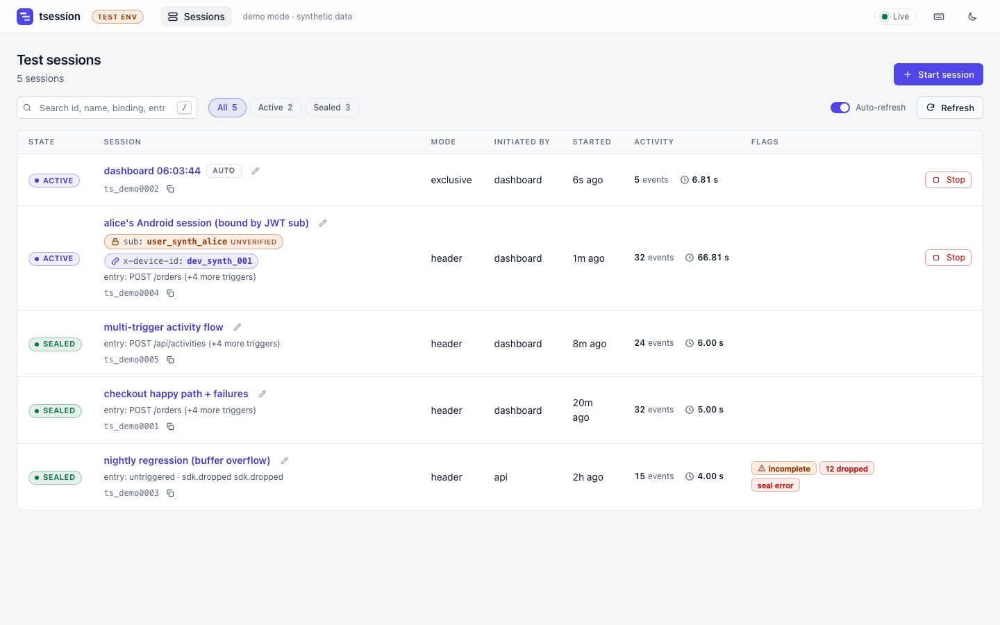

# tsession

Session-scoped tracing and data-mutation capture for **test environments**.

Start a *session*, exercise the system, stop the session. tsession then shows, for that session only, what ran,
in what order, across which services, and which rows, keys and documents changed (before and after).

It is not a general-purpose APM: traffic outside a session is not recorded.

## Quick start

Requires Go 1.25+.

```bash
# UI with synthetic data, nothing else needed
go run ./cmd/dashboard -demo            # http://127.0.0.1:7072

# Real stack, three terminals
go run ./collector/cmd/collector        # :7071
go run ./cmd/controlplane               # :7070
go run ./cmd/dashboard                  # :7072

# Or everything in containers (Postgres + Redis + all services)
cp docker/.env.example docker/.env      # synthetic dev values; edit before use
make up && make demo && make down
```

Instrument a service:

```go
import (
    "github.com/maheshpaliwal/agentic-test-session/sdk/autoinit" // configures itself from TSESSION_* env vars
    "github.com/maheshpaliwal/agentic-test-session/thttp"
)

handler := thttp.Handler(mux)               // inbound: attribution + capture
client  := thttp.Client(http.DefaultClient) // outbound: propagation
```

Then start a session (dashboard, `tracectl start`, or `POST /v1/sessions`) and send traffic with
`x-tsession-id: <id>`, or with an attribute bound to the session (user-id header, JWT claim, cookie, query
param; see [`docs/BINDING.md`](docs/BINDING.md)). Only the first instrumented hop needs it; the session
propagates downstream, including through message queues.

## How it works

```
 tester ──▶ dashboard :7072 ──▶ control plane :7070   owns session state; stop drains async work, then seals
                 │ reads                │ active set (SSE)
                 ▼                      ▼
            collector :7071 ◀── services with the SDK   events, redacted in-process, sent as protobuf
```

| Component | Role |
|---|---|
| **SDK** (`core/`, `sdk/`) | In-process recorder. Follows the control plane's active set, buffers events, exports batches. Never fails or blocks the host. |
| **Wrappers** (`thttp/`, `contrib/*`) | HTTP, gRPC, SQL, Redis (go-redis v8 and v9), Mongo, DynamoDB, queues (Kafka, SQS, AMQP). Mutations are captured with before/after images and transaction outcome. |
| **Control plane** (`controlplane/`) | Session lifecycle (`CREATED → ACTIVE → DRAINING → SEALED`, plus `ABORTED`/`EXPIRED`), bindings, names, TTL. |
| **Collector** (`collector/`) | Idempotent ingest, ordering, trace tree, entity views, storage. |
| **Dashboard** (`dashboard/`) | Timeline, call tree, entity history with diffs. No build step, no external requests. |
| **tracectl** (`cmd/tracectl`) | CLI for sessions and results. |

Wire contract, endpoints and hardening rules: [`docs/PROTOCOL.md`](docs/PROTOCOL.md).

## Dashboard

Screenshots from `go run ./cmd/dashboard -demo` (synthetic data).




## Reading results

The CLI and the Go client read the same collector API as the dashboard.

```bash
tracectl stop my-run --wait
tracectl summary my-run                      # counts, mutations, failures
tracectl events my-run --kind 'db.*' --errors
tracectl entities my-run                     # what the session changed
tracectl history my-run postgres orders 42   # every change to one row, with diffs
tracectl export my-run -o run.ndjson

# CI gate: exit 3 on failed events or an incomplete session
tracectl summary my-run --fail-on-error --fail-on-incomplete
```

```go
sess, _ := client.Start(ctx, client.Options{Name: "checkout"})
// ... drive the system with sess.Header() or sess.Transport(nil) ...
if _, err := sess.StopAndWait(ctx); err != nil { t.Fatal(err) }

sum, _ := sess.Summary(ctx)
if len(sum.Failures) > 0 { t.Fatalf("failures: %+v", sum.Failures) }
```

## Storage

Choose the collector's backend with `--store` (or `TSESSION_COLLECTOR_STORE`):

| `--store` | Use it for | Settings |
|---|---|---|
| `mem` (default) | local runs; lost on restart | none |
| `pg` | durable, SQL-queryable | `--pg-dsn`, `--pg-schema` |
| `mongo` | document store | `--mongo-uri`, `--mongo-db` |
| `dynamodb` | AWS | `--dynamo-table`, `--dynamo-region`, `--dynamo-endpoint`, `--dynamo-create-table` |

Prefer the `TSESSION_COLLECTOR_*` environment variables for connection strings; flag values show up in the
process list. The `dynamodb` backend has only been tested against an in-process fake, not a real DynamoDB.

Sessions are kept until removed:

- `--retention 168h` (`TSESSION_COLLECTOR_RETENTION`) deletes sessions that long after their seal. Default `0`
  keeps everything.
- `tracectl delete <id|name>` removes one finished session.

## Operations

- `GET /metrics` on the collector and control plane (Prometheus text format). A scraper in another container
  needs its Host value in `--allowed-hosts`.
- On SIGINT/SIGTERM the collector writes buffered events to the store before exiting.
- Every binary accepts `-version`.
- `POST /v1/ingest` accepts protobuf only, so `curl` with a JSON body does not work; see
  [`docs/PROTOCOL.md`](docs/PROTOCOL.md).

## Development

```bash
make build     # every module in the workspace
make lint      # staticcheck
make unit      # unit tests
make race      # unit tests under the race detector
make it        # integration suite (needs throwaway Postgres/Redis, see integration/scripts/it.sh)
```

More in [`CONTRIBUTING.md`](CONTRIBUTING.md). Packages under `internal/` are not stable.
