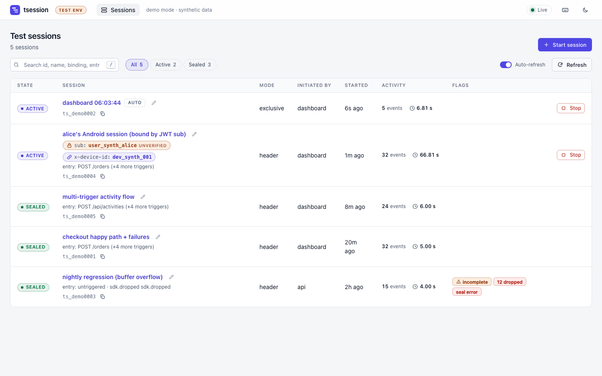
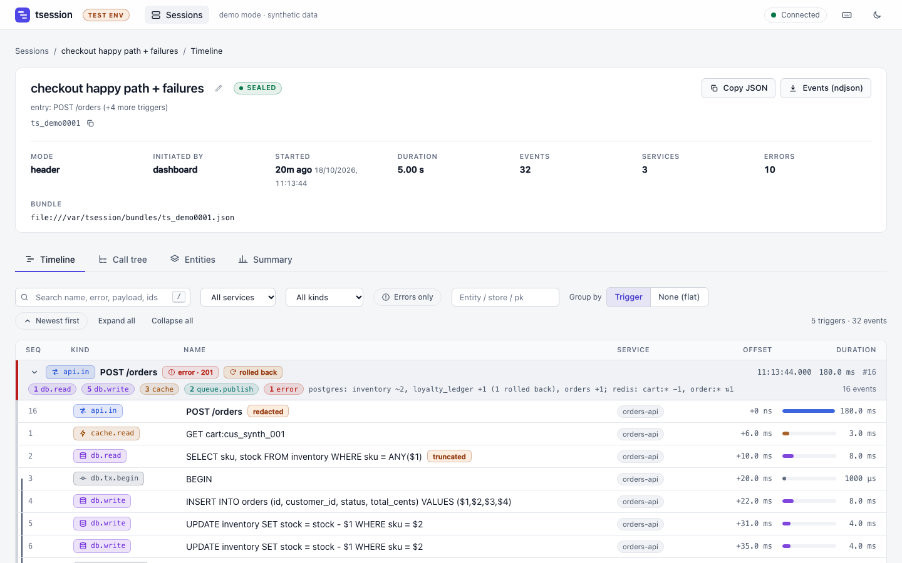
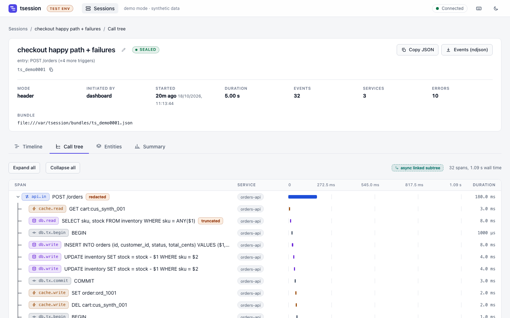
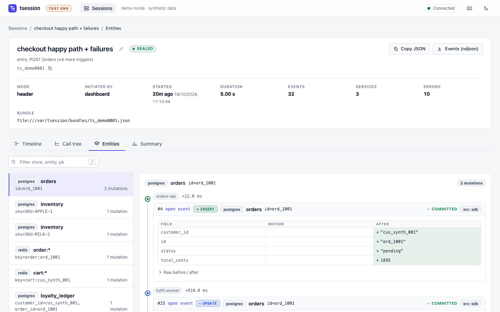

# tsession

Session-scoped distributed tracing and data-mutation capture for **test environments**.

A tester starts a *session*, exercises the system (an app, an API, a batch of queue jobs), and stops it.
tsession then answers, for that session only: *what ran, in what order, across which services, and exactly
which rows/keys/documents changed (before and after) as a result?*

It is not a general-purpose APM. It trades breadth for a narrow, high-fidelity question: **"what did my test
do to the system?"** Traffic outside the session is not recorded.

## Why this exists

Conventional tracing samples requests and shows latency. Debugging a failed end-to-end test usually needs the
opposite: every operation caused by one tester's actions, including asynchronous fallout (queue consumers,
retries, DLQs), plus the resulting state changes with transaction outcomes (committed vs rolled back).
tsession provides that by combining three ideas:

1. **Explicit sessions with a lifecycle**, owned by a control plane (`CREATED → ACTIVE → DRAINING → SEALED`,
   plus `ABORTED`/`EXPIRED`). Stopping a session drains in-flight async work before sealing, so the record is
   complete rather than cut off mid-flight.
2. **Attribution without client changes.** Requests join a session via an explicit `x-tsession-id`, or via
   *bindings* on an attribute the client already sends (user-id header, JWT claim, cookie, query param).
   Only the first instrumented hop needs the attribute; propagation carries it downstream, including through
   message queues.
3. **Mutation capture at the driver/client layer** (SQL, Redis, Mongo, DynamoDB), with before/after images,
   transaction resolution, and redaction applied *before* data leaves the process.

## Architecture

```
                       ┌──────────────┐  start/stop/rename   ┌───────────────┐
        tester ───────▶│  dashboard   │─────────────────────▶│ control plane │  :7070
                       │   :7072      │◀── SSE active set ───│ session FSM   │
                       └──────┬───────┘                      └───────┬───────┘
                              │ read API                  active-set │ drain-status / seal
                              ▼                            (SSE)     ▼
 ┌─────────────────────┐  NDJSON  ┌────────────────────────────────────────┐
 │ service A + SDK     │─────────▶│ collector :7071                        │
 │  thttp / tgrpc /    │ /v1/ingest│  idempotent ingest, reorder window,    │
 │  tsql / tredis /    │          │  gapless Seq, trace tree, entity views │
 │  tmongo / tdynamo / │          │  store: in-memory | Postgres           │
 │  tqueue             │          └────────────────────────────────────────┘
 └─────────────────────┘
 ┌─────────────────────┐   (same SDK; sessions propagate via traceparent,
 │ service B / workers │    x-tsession-id and queue carriers)
 └─────────────────────┘
```

| Component | Role |
|---|---|
| **SDK runtime** (`sdk/`, `core/`) | In-process recorder; subscribes to the control plane's active set (kill switch included), buffers events, exports batches. Designed to never fail or block the host. |
| **Control plane** (`controlplane/`, `cmd/controlplane`) | Owns session state, bindings, naming, TTL, drain and seal orchestration with retry. Optional file-backed store plus archive. |
| **Collector** (`collector/`) | Idempotent ingest on `(session, instance, local_seq)`, per-session reorder window, gapless `Seq` assignment, pending-async ledger, tx resolution, resolved views. |
| **Dashboard** (`dashboard/`, `cmd/dashboard`) | Embedded vanilla-JS UI (no build step, no external requests): timeline grouped by trigger, call tree, entity history with diffs, summary. `-demo` runs with synthetic data. |
| **tracectl** (`cmd/tracectl`) | CLI for sessions, plus `watch-docker` to start/stop sessions from container labels. |
| **Wrappers** (`thttp/`, `contrib/*`) | Instrumentation for HTTP, gRPC, SQL, Redis (go-redis v8 and v9), Mongo, DynamoDB, queues (Kafka, SQS, AMQP). |

Full wire contract, endpoints, ordering and hardening rules: [`docs/PROTOCOL.md`](docs/PROTOCOL.md).
Bindings model: [`docs/BINDING.md`](docs/BINDING.md).

## Dashboard

Screenshots from `go run ./cmd/dashboard -demo` (synthetic data).

**Sessions**: live and sealed sessions, bindings, incomplete/dropped flags.



**Timeline**: events grouped by trigger, with errors, rollbacks and per-trigger mutation summaries.



**Call tree**: api → db/cache/queue → worker, with async work linked back to its publisher.



**Entities**: per-row mutation history with before/after diffs and commit/rollback outcome.



## Repository layout

```
core/            event model, span/payload API, redaction, bindings, loopback guard   (stdlib only)
sdk/             runtime (recorder, exporter, subscriber), client, autoinit
thttp/           HTTP server middleware + client transport
controlplane/    session manager, drain/seal orchestration, bindings, names, file store
collector/       ingest, sequencer, views, bundle, store/{mem,pg}                       (own module)
dashboard/       Go proxy + embedded web UI, demo data
cmd/             controlplane, dashboard, tracectl
contrib/         tsql tredis tredisv8 tmongo tdynamo tgrpc tqueue tkafkaconfluent       (one module each)
internal/redisx  Redis logic shared by tredis and tredisv8
integration/     end-to-end harness against real Postgres/Redis
docker/          Dockerfiles, compose stack, env template
docs/            protocol, bindings, module notes
```

## Quick start

Requires Go 1.25+ (`go.work` is set to 1.26).

```bash
# UI with synthetic data, no other services needed
go run ./cmd/dashboard -demo            # http://127.0.0.1:7072

# Real stack, three terminals
go run ./collector/cmd/collector        # :7071 (in-memory store by default)
go run ./cmd/controlplane               # :7070
go run ./cmd/dashboard                  # :7072

# Or the containerised stack (Postgres + Redis + all services)
cp docker/.env.example docker/.env      # synthetic dev values; edit before use
make up
make demo                               # starts and stops a session end to end
make down
```

Instrument a service:

```go
import (
    "github.com/maheshpaliwal/agentic-test-session/sdk/autoinit"
    "github.com/maheshpaliwal/agentic-test-session/thttp"
)

// autoinit wires the runtime from TSESSION_* environment variables.
handler := thttp.Handler(mux)           // inbound: session attribution + capture
client  := thttp.Client(http.DefaultClient) // outbound: propagation
```

Then start a session (`POST /v1/sessions`, `tracectl`, or the dashboard) and send traffic with
`x-tsession-id: <id>` or an attribute bound to the session.

## Development

```bash
make build     # every module in the workspace
make vet
make unit      # unit tests for every module except integration
make it        # integration suite (needs throwaway Postgres/Redis, see integration/scripts/it.sh)
make test      # unit + integration
```

Conventions: a change stays inside one module's `go.mod`; wrappers must be fail-open; new wire fields are
additive and documented in `docs/PROTOCOL.md`.

## Status

v1 protocol, JSON over HTTP (NDJSON batches, SSE active set). No protobuf or codegen. Interfaces under
`internal/` are not stable.
