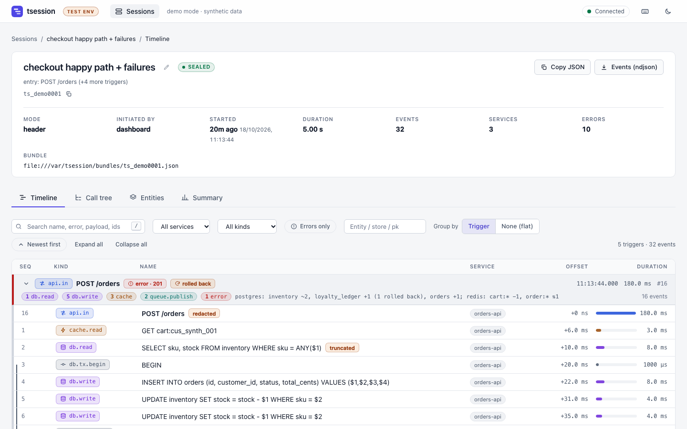
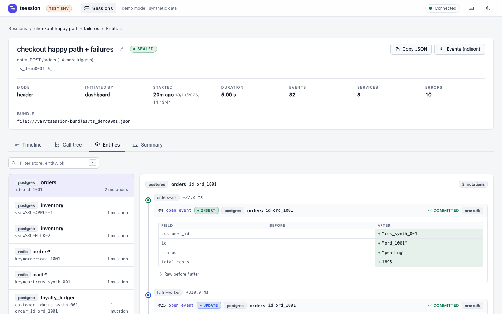

# tsession

Session-scoped tracing and data-mutation capture for **test environments**.

## What it does

Start a *session*, exercise the system, stop the session. tsession then shows, for that session only:

- **what ran**: every inbound request, outbound call, query, cache command and queue message;
- **in what order and where**: one timeline and one call tree across all the services involved, including work
  that continued through a message queue;
- **what changed**: each row, key and document that was written, with before and after values where the store
  allows it and, for SQL, whether the transaction committed or rolled back.

It is not a general-purpose APM: traffic outside a session is not recorded. It records request and response
payloads, masked by field name only, so run it against test data. See [`SECURITY.md`](SECURITY.md).

What it costs: the services are Go, each gets one import and a wrapper around its handlers and clients, and
three small processes run next to them (collector, control plane, dashboard). What it can miss is listed in one
place: [`docs/LIMITS.md`](docs/LIMITS.md).

The screenshots below come from the built-in demo, which needs nothing else running:

```bash
go run ./cmd/dashboard -demo            # http://127.0.0.1:7072, synthetic data
```

### Scenario: which test runs exist, and can they be trusted


The sessions list is the starting point. Each row is one recording.

- **State.** `ACTIVE` sessions are still recording and can be stopped here. `SEALED` sessions are finished and
  read-only.
- **How requests joined.** `header` sessions record only requests that carry the session. The second row is
  bound to a user instead: every request with JWT subject `user_synth_alice` or device id `dev_synth_001`
  joins it, so a tester can record a phone without changing the app. `exclusive` (first row) records every
  request while it runs.
- **Whether the recording is complete.** The last row is flagged `incomplete`, `12 dropped` and `seal error`:
  an SDK buffer overflowed and the seal failed. Results from such a session should not be asserted on.

### Scenario: a checkout that half-failed



The timeline groups events by the request that triggered them. Here one `POST /orders` produced 16 events in
180 ms, and the header line already tells the story without expanding anything:

- 1 read, 5 writes, 3 cache commands, 2 queue publishes, 1 error;
- the net effect on data: two `inventory` rows updated, one `orders` row inserted, one `loyalty_ledger` insert
  that was **rolled back**, one `cart:*` key deleted;
- the `rolled back` chip marks the trigger, so a test that only checked the HTTP status would have missed it.

Below it, the events in order: the cart read from Redis, the stock check, then `BEGIN` and the writes inside
the transaction (the bar on the left marks them). `redacted` and `truncated` chips show where a payload was
masked or cut.

### Scenario: where the time went, across services


The call tree shows the same session as parent and child spans with a waterfall. It answers "what called what"
and "what was slow". Work that a queue consumer did later is attached to the request that published the
message, marked `async linked subtree`, so a background worker's writes appear under the checkout that caused
them. The session here spans 3 services and 32 spans in 1.09 s of wall time.

### Scenario: what happened to one row



The entities view lists everything the session changed, by store and key. Selecting `orders id=ord_1001` shows
its history: an `INSERT` by `orders-api` at +22 ms with every field's new value, then an `UPDATE` by
`fulfil-worker` at +810 ms. Each change says which service made it, whether it committed, and links to the
event that caused it. This is the view to use for "who set this status, and when".

## Set up

Building this repository needs Go 1.26 (`go.work`); importing the modules needs Go 1.25+.

### 1. Run the services

```bash
# three terminals
go run ./collector/cmd/collector        # :7071
go run ./cmd/controlplane               # :7070
go run ./cmd/dashboard                  # :7072

# or everything in containers (Postgres + Redis + all services)
cp docker/.env.example docker/.env      # synthetic dev values; edit before use
make up                                 # then open http://127.0.0.1:7072
make down                               # when finished; this also deletes the recorded data
```

To move a port: `--listen` (collector, control plane), `-listen` (dashboard). Then point the services and
`tracectl` at the new addresses with `TSESSION_CONTROLPLANE_URL` and `TSESSION_COLLECTOR_URL`, the control plane
at the collector with `--collector-url`, and the dashboard at both with `-control-plane` and `-collector`. Run the collector
from a directory you choose: it writes sealed bundles to `./bundles` there.

### 2. Instrument a service

```go
import (
    _ "github.com/maheshpaliwal/agentic-test-session/sdk/autoinit" // starts the SDK from TSESSION_* env vars
    "github.com/maheshpaliwal/agentic-test-session/thttp"
)

func main() {
    handler := thttp.Handler(mux)               // inbound: attribution + capture
    client  := thttp.Client(http.DefaultClient) // outbound: propagation
    // ...
}
```

```bash
TSESSION_ENABLED=true \
TSESSION_SERVICE=orders-api \
TSESSION_CONTROLPLANE_URL=http://127.0.0.1:7070 \
TSESSION_COLLECTOR_URL=http://127.0.0.1:7071 \
  ./orders-api
```

- Wrap handlers and clients inside `main` or functions it calls. The wrappers decide once, when called, whether
  the SDK is on; a package that wraps at init time must itself import `autoinit`.
- `autoinit` also traces `http.DefaultTransport`. `thttp.Client` sends session headers to every host it calls,
  third parties included; `TSESSION_PROPAGATE_HOSTS` and `TSESSION_NO_PROPAGATE_HOSTS` apply only to the default
  transport.
- Other wrappers live under `contrib/`: gRPC, SQL, Redis (go-redis v8 and v9), Mongo, DynamoDB, queues (Kafka,
  SQS, AMQP). Each package's doc comment shows its setup.
- `contrib/tsql` supports Postgres and MySQL only. It reads each table's primary key from the database catalog
  (once per table per `sql.DB`, refreshed every 30 seconds), so rows are recorded under their real key whatever it is called. Declare the key
  with `tsql.WithPKColumns` for a table without a primary key or a view. Flags on a write say what could not
  be captured: `pk_unknown` (no key value was found for the row), `after_unavailable` (an updated row could not
  be read back, so the record has its before image and no diff), `pk_not_unique` (the key columns matched more
  than one row, so no new values were recorded), `pk_lookup_failed` (the catalog could not be read),
  `upsert_unknown` (whether an upsert inserted or updated is not known; no diff) and `effects_unknown` (a `DO`
  or `CALL`: the rows it changed are not recorded). The package doc has the details.

### 3. Record a session

```bash
go install ./cmd/tracectl                # puts tracectl on your PATH; or: go run ./cmd/tracectl <command>

tracectl doctor                          # both services answer; which services are connected
                                         # (CI preflight: --require-services N exits 3 with fewer than N
                                         #  connected SDK instances; replicas count one each.
                                         #  --require-delivery exits 3 when a connected service says that it
                                         #  cannot reach its collector: see below)
ID=$(tracectl start --name my-run --id-only)   # without --id-only: the session as JSON
curl -H "x-tsession-id: $ID" http://127.0.0.1:8080/orders   # a request to YOUR service from step 2
tracectl stop my-run --wait              # drains async work, then seals
```

`doctor` lists every connected service. "Connected" means that the service follows the control plane; whether it
can also deliver is a second question, and a service with a wrong `TSESSION_COLLECTOR_URL` used to look healthy
until a session ran and its events were missing. Each service now asks its collector's `/healthz` when it starts
and every 30 seconds while it has nothing to send (so an outage shorter than that can pass unseen), and tells the control plane what it found, with no session
running:

```
connected services  2
  inventory                inventory-1                  connected 12s
  orders-api               orders-api-1                 connected 12s  CANNOT REACH COLLECTOR: Get http://collector:7071/healthz: dial tcp: lookup collector: no such host
note: orders-api cannot reach its collector, so nothing it records would arrive: check TSESSION_COLLECTOR_URL of orders-api (it must be the collector's address as seen from that service)
```

`tracectl doctor --require-services N --require-delivery` is the preflight for CI: exit 3 when fewer than N services
are connected, or when one of them says that it cannot reach its collector. A service says so within a few seconds of
starting (at once when the connection is refused, after its 2 s timeout when nothing answers), and takes it back
about 5 s after the collector answers. During a run the same flag also fails on a
service that holds events it cannot deliver (`CANNOT DELIVER`) or whose reports do not arrive
(`NO DELIVERY REPORTS`). What the check cannot see: a service built with an SDK from before it says nothing about
its collector and passes (not known is not a failure), and a URL at which something other than a collector answers
HTTP counts as reached. Credentials in a collector URL are never shown.

No service wired yet? The repository has one that needs no database. Start it in a second terminal, with the
four variables of step 2; it stays in the foreground:

```bash
cd integration && DELIVERYAPP_LISTEN=127.0.0.1:8080 TSESSION_ENABLED=true TSESSION_SERVICE=sample \
  TSESSION_CONTROLPLANE_URL=http://127.0.0.1:7070 TSESSION_COLLECTOR_URL=http://127.0.0.1:7071 \
  go run ./cmd/deliveryapp
```

Then, in the terminal where `$ID` is set, send it a request in place of the `curl` above:

```bash
curl -X POST -H "x-tsession-id: $ID" http://127.0.0.1:8080/work
```

`stop`, `abort`, `rename` and `wait` print the session as JSON; `status` adds `name:` and `bindings:` lines after
it, so it is not pure JSON. With `--short` all five print one line, `<id> <STATE>`, followed by ` incomplete`
when the session is.

A request joins a session through `x-tsession-id: <id>`, or through an attribute bound to the session (user-id
header, JWT claim, cookie, query parameter; see [`docs/BINDING.md`](docs/BINDING.md)). Only the first
instrumented hop needs it; the session propagates downstream, including through message queues. A session
started with `--mode exclusive` records every request while it runs.

### 4. Read the results

Open the dashboard at http://127.0.0.1:7072, or use `tracectl`:

```bash
tracectl summary my-run                      # counts, mutations, failures
tracectl events my-run --kind 'db.*' --errors
tracectl entities my-run                     # what the session changed; "N uncertain" = incomplete key or image
tracectl history my-run postgres orders 42   # every change to one row, with diffs and the event's flags
tracectl history my-run redis 'user:*' user:1   # a Redis key; diffs need tredis.WithBeforeImage (see its doc comment)
# a key that holds a secret is recorded masked ("session:#1f2e3d4c5b6a"): copy it from `tracectl entities`;
# it cannot be found by its real name, and it reads differently in each service
tracectl history my-run postgres items order_id=7,sku=a   # composite key; or the JSON that entities prints
tracectl history my-run postgres orders --unknown-key     # changes recorded without a key
tracectl trace my-run --errors               # call tree, only branches that failed
tracectl show my-run 17                      # one event in full: request, response, mutations
tracectl diff nightly-ok nightly-failed      # what differs between two runs
tracectl list --limit 20                     # the newest sessions; INCOMPLETE marks a record with known gaps
```

A failed event is one that returned an error or an HTTP status of 500 or above; a 4xx response is recorded
but does not count as a failure. A gRPC call follows the same line: the
statuses that say the callee failed count (`Internal`, `Unavailable`, `Unknown`, `DeadlineExceeded`,
`Unimplemented`, `DataLoss`), `NotFound` or `Canceled` do not (see the `contrib/tgrpc` doc comment).

Exit status: `0` ok, `1` failed (including bad arguments to a command; `run` and `--from` exit `2` for those),
`2` unknown command or global flag, `3` a `--fail-on-*` check failed. `tracectl run` exits with its command's status instead when that failed.

## Architecture

```
 tester ──▶ dashboard :7072 ──▶ control plane :7070   owns session state; stop drains async work, then seals
                 │ reads                │ active set (SSE)
                 ▼                      ▼
            collector :7071 ◀── services with the SDK   events, redacted in-process, sent as protobuf
```

| Component | Role |
|---|---|
| **SDK** (`core/`, `sdk/`) | In-process recorder. Follows the control plane's active set, buffers events, exports batches. Fail-open: recording errors never reach the host, and the work it adds inside a session is bounded. |
| **Wrappers** (`thttp/`, `contrib/*`) | Record calls and, per row, key or document, mutations. Before/after images where the store allows (SQL and DynamoDB by default, Redis opt-in, Mongo for findAndModify), with the transaction outcome for SQL. |
| **Control plane** (`controlplane/`) | Session lifecycle (`CREATED → ACTIVE → DRAINING → SEALED`, plus `ABORTED`/`EXPIRED`), bindings, names, TTL. |
| **Collector** (`collector/`) | Idempotent ingest, ordering, trace tree, entity views, storage. |
| **Dashboard** (`dashboard/`) | Timeline, call tree, entity history with diffs. No build step, no external requests. |
| **tracectl** (`cmd/tracectl`) | CLI for sessions and results. |

How a recording moves through it:

1. **Start.** The control plane creates the session and publishes it in the *active set*. Every SDK follows
   that set over a server-sent-events stream, so services learn about a new session without being restarted.
2. **Attribute.** A wrapper on the first instrumented hop matches the request to an active session, by the
   `x-tsession-id` header or a bound attribute. The SDK then carries the session on every outbound call and
   queue message, so downstream services need no matching of their own. Requests that match nothing are not
   recorded.
3. **Capture.** Wrappers emit events for calls and mutations. The SDK redacts them inside the service's own
   process, buffers them, and sends batches to the collector as protobuf. The collector ingests them
   idempotently, orders them, and serves the call tree and the per-entity views from them.
4. **Stop.** The control plane moves the session to `DRAINING` and waits for the collector to go quiet, so
   asynchronous work still in flight is included. It then asks the collector to seal.
5. **Seal.** The collector seals the session and writes its bundle. A drain that timed out or a seal that
   failed marks the session `incomplete`.

Design choices that follow from "test environments only":

- **Separate state from data.** The control plane owns session state; the collector owns the events and
  their storage.
- **The host service comes first.** The SDK is fail-open and bounded, and `tracectl kill on` stops recording
  everywhere at once.
- **Local by default.** All three servers bind `127.0.0.1` unless configured otherwise, and the control plane
  and collector accept loopback Host names only; add others with `--allowed-hosts`.
- **Few dependencies.** The root module (`core`, `thttp`, `sdk`, `controlplane`, `dashboard`, `cmd`) uses the
  standard library only. Third-party drivers stay in the `contrib/*` and `collector` modules that need them.

Every setting and its default: [`docs/CONFIG.md`](docs/CONFIG.md). Wire contract, endpoints and hardening rules:
[`docs/PROTOCOL.md`](docs/PROTOCOL.md).

## Using it from an AI agent

```bash
tracectl run --name my-run --digest digest.md -- ./run-e2e.sh   # record the tests; or: start, run them, stop --wait
tracectl digest my-run --fail-on-error --fail-on-incomplete --fail-on-empty   # the one call to read the result
tracectl show my-run 17                                         # then drill down: one event in full
tracectl history my-run postgres orders 42                      # every change to one row

# no services running, only the artifact of a run (tracectl run --export run.ndjson -- ..., or
# tracectl export my-run -o run.ndjson):
tracectl --from run.ndjson digest --fail-on-error --fail-on-incomplete --fail-on-empty
tracectl --from run.ndjson show 17                              # the digest names these commands itself
```

`digest` is the whole session in at most `--max-bytes` (default 16384): verdict and counts, each failure with its
root request and ancestors, mutations per entity (changed fields, transaction outcome, flags; `UNCERTAIN` marks
an incomplete key or row image), and the call tree with repeated siblings collapsed (`40x` is an N+1). What did
not fit is listed under "Omitted" with the command that prints it. Recorded text is quoted as data and cannot
alter the digest's structure; a model can still be swayed by what it says. `--format json` prints one JSON
object (schema `tsession.digest/v1`); `summary`, `events`, `entities`, `history`, `trace`, `show` and `diff`
take `--json`. Exit statuses are those above: `0` from the `digest` line means no failed events, complete, not
empty. A live session works too and says so. Details: [`docs/DIGEST.md`](docs/DIGEST.md).

`--from FILE` reads an export instead of the services: nothing has to run and nothing is asked. It works with
the commands that read (`digest`, `summary`, `report`, `events`, `trace`, `show`, `entities`, `history`, `diff`,
`status`, `list`); they print what they print for the session the file was exported from and exit as they do
for it, `--fail-on-*` gates included. The session need not be named (the file holds one); when it is, by its id,
its name or the file's name without the extension, it has to be the file's. Any other command with `--from`
exits 2. A session that was exported while it ran is shown as running: its events are those that had arrived.
`--from` goes before the command. The file may be gzip'ed, and `--from -` reads standard input.

| `tracectl run` exits | It means | Next |
|---|---|---|
| `0` | the command passed and every gate held | nothing |
| `3` | a gate failed: failed events, an incomplete or an empty session | read "Verdict" and "Failures" in the digest, then `show <seq>` |
| `1` | the session could not be stopped, sealed or read | `tracectl doctor`; the recording cannot be relied on |
| `2` | wrong usage of `tracectl` | fix the command line |
| anything else | the command's own status (`128+n`: killed by signal `n`) | the command's output; the digest is still written, except for `126`/`127` (the command could not be started, so no session was) |

A command that itself exits 1, 2 or 3 looks the same; the line `tracectl: the command failed: exit status N` on
stderr tells them apart. Do not assert on a mutation marked `UNCERTAIN`: its key or values were not fully
captured. The follow-up commands print everything unless bounded (`events --limit N`, `trace --depth N`). The
gates only see what reached the collector (see the limit under "Go tests and CI").

## Go tests and CI

`sdk/client/tsessiontest` ties a session to a test and asserts on what it recorded:

```go
sess := tsessiontest.Run(t, client.Options{})   // stopped when the test ends
// ... drive the system with sess.Header() or sess.Transport(nil) ...
tsessiontest.RequireNoFailures(t, sess)
tsessiontest.RequireMutation(t, sess, client.MutationFilter{Store: "postgres", Entity: "orders", Op: "insert"})
tsessiontest.RequireEvent(t, sess, tsessiontest.EventFilter{Service: "orders-api", Kind: core.KindAPIOut, Name: "/charge"})
```

A failed event is one that carries an error: an HTTP 500 or above, a failed query, a failed job. A request that
was refused (a 404) is not one. A test that provokes a failure asserts on it with `tsessiontest.RequireFailure`
in place of `RequireNoFailures`. An assertion that does not hold fails its test; a set-up that is broken (no
control plane) panics, which ends the package's test binary.

Stopping a session waits for it to go quiet (3s by default), so each such test takes a few seconds; lower
`client.Options.QuiesceSeconds` if your system has no asynchronous work.
When a service still holds events it cannot deliver, or its reports do not arrive, the stop waits about ten
seconds more for it (`--delivery-grace` on the control plane), and 12 to 18 seconds while its reports are
failing, before it calls the session incomplete.

`sdk/client` gives the same data directly (`Start`, `StopAndWait`, `Summary`, `Events`, `Mutations`, `History`,
`Trace`).

Such tests need only `go test`. Under `tracectl run -- go test ./...` they still record in their own sessions,
and the session of `tracectl run` stays empty (`--fail-on-empty` then fails). To record a whole `go test` as one
session instead, let the tests join it, and leave the verdict to the gates of `tracectl run`:

```go
sess := tsessiontest.Ambient(t, client.Options{})   // the session in $TSESSION_ID; fails the test without one
// ... drive the system with sess.Header() or sess.Transport(nil); no Require calls: the session is shared ...
```

Outside a test, `client.AttachEnv` returns the same session.

```bash
# one line: start a session, run the tests with its id in $TSESSION_ID, stop, wait for the seal, print the summary
tracectl run --name my-run --fail-on-error --fail-on-incomplete --fail-on-empty --report tsession.md -- ./run-e2e.sh
# Exit status: the command's own if it failed (128+n if killed by signal n); else 1 if the session could not be
# stopped, sealed or read; else 3 if a gate failed; else 0. The session is stopped and sealed either way.
# stdout is the command's: tracectl prints to stderr and writes the report (replacing FILE; --format junit for XML).
# The command runs in its own process group, so it cannot read from the terminal; give --ttl more than its runtime.

# or step by step, on a session that has been stopped
# gate: exit 3 on failed events, an incomplete session (a failed seal or timed-out drain included, or a session
# the control plane no longer knows), or no events at all
tracectl report my-run --fail-on-error --fail-on-incomplete --fail-on-empty >> "$GITHUB_STEP_SUMMARY"
tracectl report my-run --format junit -o tsession-junit.xml
# A service that could not deliver its events (wrong TSESSION_COLLECTOR_URL) makes the session incomplete and is
# named. A connected service whose reports do not arrive is "delivery unconfirmed": that passes the gates above;
# add --fail-on-unconfirmed where every connected service is yours (not in a shared environment).
# Still not seen: a service that is killed before it ever reports, and one running an older SDK.

# keep a run after the job is gone: export it, then open the file without the services. The export carries
# the session's verdict (alone, when there are no events), so the gates exit for the file as for the session.
tracectl export my-run -o run.ndjson
# read the file with the same commands as a live session (summary, events, trace, entities, history, show,
# report, digest, diff, status, list); nothing else has to run, and the session need not be named
tracectl --from run.ndjson digest --fail-on-error --fail-on-incomplete
tracectl --from run.ndjson report --format junit -o report.xml
tracectl --from baseline.ndjson --from run.ndjson diff --fail-on-diff   # two files: baseline, then candidate
go run ./cmd/dashboard -open run.ndjson      # or the UI; it prints the --cp and --collector that read it too

# or let failed Go tests save theirs
TSESSION_ARTIFACT_DIR=$PWD/artifacts go test ./...
```

Two jobs, the second without any service: the first records and keeps the files whatever happens, the
second gates on the artifact. `run --export` writes the status of its command into the file, so the gate also
fails for a run whose tests failed without a failed event. `--require-services 3` (the number of services you
expect) does not run the tests with fewer connected, and fails the run when one of them is gone at the end: a
service that is killed takes what it had not delivered with it, and nothing else may show that.

```yaml
# GitHub Actions; the same three commands work in any CI system
jobs:
  e2e:
    runs-on: ubuntu-latest      # with your services, the collector and the control plane started before this step
    steps:
      - run: >
          tracectl run --name "e2e-${{ github.run_id }}" --require-services 3
          --export run.ndjson --digest digest.md --report report.md
          -- ./run-e2e.sh
      - if: always()            # also when the tests failed: that is when the files are wanted
        uses: actions/upload-artifact@v4
        with: { name: tsession, path: "run.ndjson\ndigest.md\nreport.md" }
  gate:
    runs-on: ubuntu-latest      # needs tracectl only: no service runs here
    needs: e2e
    if: always()
    steps:
      - uses: actions/download-artifact@v4
        with: { name: tsession }
      - run: tracectl --from run.ndjson report --fail-on-error --fail-on-incomplete --fail-on-empty >> "$GITHUB_STEP_SUMMARY"
```

`tracectl --from FILE <command> --fail-on-*` exits `0` when the checks hold, `3` when one does not (failed
events or a failed command, an incomplete or unproven recording, no events), `1` when the file cannot be read as
an export (missing, cut short, not an export) and `2` for a command that does not read. Several artifacts are
gated one by one: `for f in artifacts/*.ndjson; do tracectl --from "$f" summary --fail-on-error || exit; done`.
`export -o FILE` and `run --export FILE` write the file; `tracectl --from FILE` and `dashboard -open FILE` read
it, the first for scripts and agents (strict), the second for a person (it shows what it can).

An export holds recorded payloads, masked by field name only. Treat it like test data, not as something safe to
share; whether it may go to CI storage is a question for your own data-handling policy. The opened session
keeps its id and its name (an export from before the name was stored is named after the file, `run` above), and
is read-only: stop, rename and delete are refused.
`tracectl --from` refuses a file that is missing, empty, not an export, or cut short (exit 1; the export says
how many events it wrote, so a file that lost whole lines is refused too; one whose first line is gone is read
with a note and fails `--fail-on-incomplete`, see [`docs/LIMITS.md`](docs/LIMITS.md)):
a gate does not judge a part of a recording. (`dashboard -open` shows a file cut short, marked incomplete.)

## Storage and retention

The collector's backend is chosen with `--store` (or `TSESSION_COLLECTOR_STORE`):

| `--store` | Use it for | Settings |
|---|---|---|
| `mem` (default) | local runs; lost on restart | none |
| `pg` | durable, SQL-queryable | `--pg-dsn`, `--pg-schema` |
| `mongo` | document store | `--mongo-uri`, `--mongo-db` |
| `dynamodb` | AWS | `--dynamo-table`, `--dynamo-region`, `--dynamo-endpoint`, `--dynamo-create-table` |

Prefer the `TSESSION_COLLECTOR_*` environment variables for connection strings; flag values show up in the
process list. The `dynamodb` backend has only been tested against an in-process fake, not a real DynamoDB. `make it` and CI
run Postgres and Redis only: the `mongo` store and `tsql` on MySQL are not exercised there, and the MySQL
primary-key lookup has never run against a live server.

- **Collector events** are kept until removed. `--retention 168h` (`TSESSION_COLLECTOR_RETENTION`) deletes
  sessions that long after their seal; the default `0` keeps everything.
- **Sealed bundles**: the collector also writes each sealed session's events to `--bundle-dir`
  (`TSESSION_COLLECTOR_BUNDLE_DIR`, default `./bundles` in its working directory; empty disables). These files
  hold recorded payloads.
- **The control plane's session list** lives in memory by default: finished sessions disappear from
  `tracectl list` and the dashboard after `--retention` (`TSESSION_CP_RETENTION`, default 24h) and on restart,
  even though the collector still has their events. `tracectl` can still read those by session id (not by
  name). Run the control plane with `--store-file FILE` (`TSESSION_CP_STORE`) to keep the list.
- `tracectl delete <id|name>` removes one finished session from both.

## Operations

- `GET /metrics` on the collector and control plane (Prometheus text format). A scraper in another container
  needs its Host value in `--allowed-hosts`.
- On SIGINT/SIGTERM the collector writes buffered events to the store, for up to 15s.
- `tracectl kill on` stops recording in every service, for every session, at once; `tracectl kill off` resumes it
  and `tracectl kill status` (or `tracectl doctor`) shows the state.
- `collector`, `controlplane` and `dashboard` accept `-version`; `tracectl version` prints tracectl's.
- `POST /v1/ingest` accepts protobuf only, so `curl` with a JSON body does not work; see
  [`docs/PROTOCOL.md`](docs/PROTOCOL.md).

## Development

```bash
make build     # every module in the workspace
make lint      # staticcheck
make unit      # unit tests
make race      # unit tests under the race detector
make it        # integration suite; starts its own Postgres and Redis from local binaries
               # (set PGBIN / REDIS_BIN; the defaults are Homebrew paths)
```

More in [`CONTRIBUTING.md`](CONTRIBUTING.md). Packages under `internal/` are not stable.
